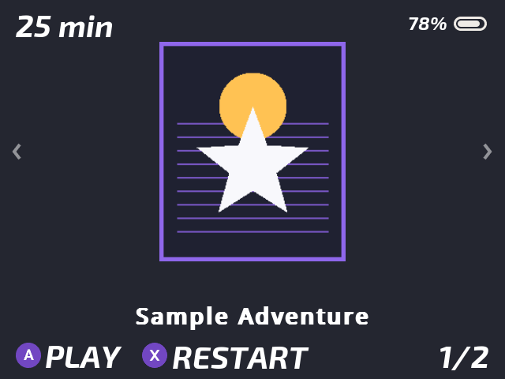
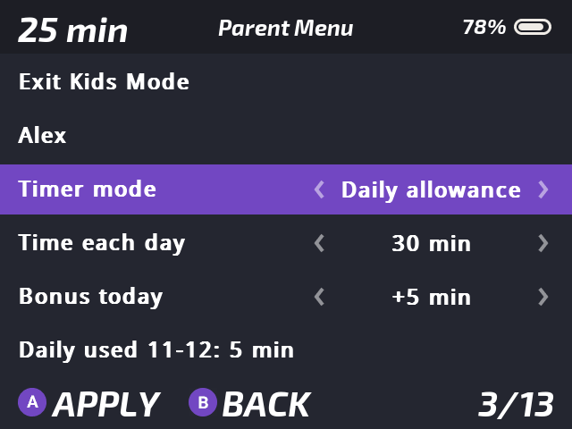
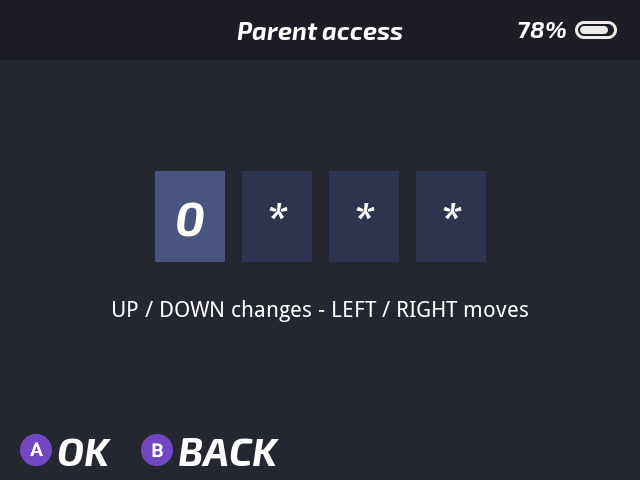

# Kids Mode for Onion OS

This branch adds **opt-in daily gameplay allowances**, recoverable multi-child saves,
and gameplay-only session timers. It builds on [whawker's multi-profile contribution (#7)](https://github.com/daverad/onion-kids-mode/pull/7).
Existing installations do not silently enable Daily. See the
[daily allowance guide](docs/daily-allowance.md) for setup, clock requirements, checks,
backup and rollback. This is an unofficial candidate with
[remaining hardware limits](docs/daily-allowance.md#verification-and-known-limits).

A fullscreen, favorites-only launcher that locks a **Miyoo Mini / Mini+**
running [Onion OS](https://github.com/OnionUI/Onion) so a young child can
use it unsupervised — big box art, one-button play, a PIN-protected exit,
and an optional play timer.

- **Boots straight into a kid-proof carousel** showing only your ★ favorited
  games: box art, big label, left/right to browse, **A** to play, **X** to
  start over. Long titles wrap onto a second line, and the battery sits
  top right exactly as it does everywhere else in Onion, with the
  play-time chip opposite it.
- **Native Onion look**: every screen renders through Onion's own theme
  engine — your active theme's background, fonts, colors, header/footer
  bars, button hints and full-width list rows — so Kids Mode feels like
  part of the OS, not an app drawn on top of it.
- **Theme menu sounds**: navigation, confirm and back use Onion's active-theme
  sound (standard fallback), respecting menu volume, master mute and zero volume.
  Kids Mode does not start background music. Audio closes before game launch.
- **Exiting a game returns to the carousel — never to Onion's menus.**
- **Three timer modes**: No limit, Single session (one handoff), or Daily allowance
  (a recurring amount for each child). Both timed modes count only while a game
  is open; menus and sleep pause the timer. Daily usage survives reboot and mode
  changes, unused time expires at local midnight, and a parent can grant a bonus
  for today. Daily warns at five and one minute; at zero, Kids Mode requests the
  normal RetroArch save/exit path and blocks new play. A failed exit is not proof
  that a save completed.
- **Auto power-off**: if the "Time's up!" screen is left alone for
  5 minutes (nobody turns the device off), it powers itself down cleanly
  instead of draining the battery.
- **Parent menu** (hold **SELECT+START 3 s** → PIN): exit Kids Mode, add
  time through **Timer mode**, **Time this session** / **Time each day**, and
  **Add to this session** / **Bonus today**. **◀ ▶** previews the amount and
  **A** applies it. Choose **No limit** to turn the timer off, set the **screen
  brightness**, flip **auto-resume**, **switch to another kid**, **add
  another kid**, or **change the PIN** — all without leaving the launcher.
- **Start over**: **X** on a game asks "Start over?" and launches from the
  beginning without touching in-game saves.
- **MENU button in-game saves and exits** back to the carousel.
- **RetroArch is locked down while armed**: settings are hidden (kiosk
  mode) *and* every documented in-game hotkey is unbound — MENU+SELECT
  (RetroArch's menu), MENU+L2/R2 (save/load state), MENU+L/R (rewind and
  fast-forward), MENU+←/→ (save slots), plus screenshots, cheats, shaders,
  disc swap and the rest. MENU+VOLUME for brightness is handled outside
  RetroArch and still works. Everything is restored from a backup on
  unlock.
- **The kid gets their own saves**: while armed, `Saves/CurrentProfile`'s
  `saves`, `states` and `romScreens` are swapped for a persistent kid
  profile, so a child can't overwrite your save states or fill the game
  switcher with their thumbnails — and their own progress is still there
  next session. Per-core settings and themes stay shared.
- **One profile per child**: add a child from the parent menu and each one
  gets their own saves, save states and game-switcher thumbnails. With two
  or more on the roster, arming asks who's playing before the timer; with
  one, nothing changes and no extra screen appears.
- **MENU+B blue-light toggle is disabled** while armed (any schedule you
  have configured still runs).
- **Auto-resume** (optional): boot straight back into the last game the
  kid played instead of the carousel. Toggle it in the parent menu.
- Survives reboots; a powered-off-mid-game session resumes on next boot.

## Screenshots

|  |  |  |
| :--: | :--: | :--: |
| *The kid's carousel — one favorite at a time, box art and all; **A** plays, **X** starts over* | *Parent menu — play time with a live preview in the header, brightness, auto-resume and change PIN* | *The PIN gate — set once when arming; **A** confirms* |

*(These screenshots show the earlier session-only interface with Onion's stock
theme. Current timer controls are described below; Kids Mode uses your active theme.)*

## Requirements

- Miyoo Mini or Mini+ running **Onion OS 4.3 or newer**.
- Games your kid should see must be **favorited** (★, press X on a game in
  Onion) and Onion's *auto save & resume* left on (it is by default).

The original launcher was tested on a Miyoo Mini Plus with Onion 4.4-beta.
The Daily candidate has been exercised on a Miyoo running **Onion v4.3.1-1**.
Automatic offline Daily setup currently supports that exact Onion version and
requires retained-clock evidence at boot. Devices without a supported retained RTC
can still use No limit and Single session. An unsupported Daily opt-in explains why
and preserves the existing timer; see [RTC checks and fallback behavior](docs/daily-allowance.md#rtc-eligibility-and-timing-checks).
Wi-Fi is not required for normal Daily use on supported hardware. Other firmware, the Mini V4's 752×560 screen and the base
Mini need separate qualification; a model name alone does not prove RTC support.

## Install

1. For an upstream release, use [Releases](https://github.com/daverad/onion-kids-mode/releases). To try this PR, use its
   successful **KidsMode-app** build artifact; release downloads do not include
   unmerged changes. Read the [backup and recovery instructions](docs/daily-allowance.md#data-and-recovery)
   and exit Kids Mode normally before replacing files.
2. Copy the `KidsMode` folder into the `App` folder on your SD card
   (so it becomes `/App/KidsMode/`). Don't replace the `App` folder itself.
3. Reboot. Nothing changes until you arm it.

## Usage

1. **Arm:** Apps tab → **Kids Mode**. First time, set + confirm a 4-digit
   PIN (up/down changes a digit, left/right moves between digits,
   A confirms).
2. If more than one child is set up, pick who's playing (**▲ ▼**, **A** to
   choose — it opens on whoever played last). With one child this step
   doesn't appear.
3. Pick **Single session** (OFF / 5–120 min) unless that child already uses
   Daily. Daily children retain their recurring budget and skip this picker.
   To enable Daily initially, enter the parent menu after arming.
4. Hand it over:

   | Button | Action |
   | ------ | ------ |
   | ◀ ▶ | browse favorites |
   | A | play (resumes where the game last stopped) |
   | X | start over (with confirmation; in-game saves untouched) |
   | MENU (in-game) | save and exit back to the carousel |
   | everything else | does nothing — no dead ends |

5. **Parent access:** hold **SELECT+START ~3 s**, enter the PIN →
   Choose **Timer mode** with **◀ ▶**: **No limit**, **Single session**, or
   **Daily allowance**. Choose **Time this session** / **Time each day** as
   applicable, then press **A**. A successful apply returns to the carousel;
   **B** discards an unapplied timer edit.
   - **Daily allowance:** resets at local midnight; **No play** means zero daily
     minutes, not unlimited play. First-time opt-in checks and configures the
     [offline clock](docs/daily-allowance.md#automatic-clock-setup).
   - **Bonus today:** adds Daily time only for today. **Add to this session**
     extends only the current session. Switching modes does not erase Daily usage.
   - **No limit:** permits unlimited play without deleting the child's Daily ledger.
   - **Switch to another kid** / **Add another kid:** use independent saves and
     Daily budgets; see below.
   - **Brightness:** **◀ ▶** changes the screen brightness as you move it,
     in 10% steps down to 10% (never fully dark) — no confirm needed, and
     it's remembered for the next session. MENU+VOLUME still works in-game,
     so a kid can change it back; this is a convenience, not a lock.
   - **Auto-resume last game:** **◀ ▶** flips it On/Off. On means the next
     boot goes straight into the last game the kid played instead of the
     carousel (it falls back to the carousel if that game is gone). The
     flip is saved the moment you make it, so **B** or *Back* both keep it.
   - **Change PIN:** set a new 4-digit PIN on the spot (no computer needed).
6. **Time's up:** the kid sees a friendly "Time's up!" screen. If the
   device is left on there, it powers off by itself after 5 minutes.

Kids Mode stays armed across reboots until you exit it via the PIN.

## More than one child

Each child gets their own `Saves/KidsProfile.<name>` folder holding their
`saves`, `states` and `romScreens`. The folders *are* the roster: there is
no list to keep in step with them, so you can add or remove a child from a
computer by making or deleting a folder, and an app update can't lose them.

- **Handing over to a sibling:** parent menu → **Switch to another kid**,
  pick the name, then a session time unless that child uses Daily. The child
  finishing keeps their saves; the incoming child uses their own saves and
  recorded Daily balance. A Single session is a fresh handoff budget; switching
  children never renews an already-used Daily allowance.
- **Add a child:** parent menu → **Add another kid**, and type the name on
  Onion's usual on-screen keyboard. It creates the profile only — the
  session that's running keeps its own saves, so use **Switch to another
  kid** when it's actually their turn.
- **The first time you add a second child**, Kids Mode asks for that kid's
  name and then for the name of the kid already playing — until now their
  profile didn't need one. Their existing progress is kept as-is under the
  name you give.
- **Names** can use letters, numbers, spaces, `-` and `_`, up to 24
  characters. They become folder names on the card, so anything else is
  refused.
- **The picker** lists children alphabetically and opens on whoever played
  last, so the usual answer is one press of **A**. It appears when arming
  and when switching, and only when there are two or more children.
- **Favorites are shared.** Every child sees the same game list; it's the
  saves, save states, thumbnails and last-played game that are separate —
  each child's carousel opens where they left off.
- **Renaming a child:** rename the `Saves/KidsProfile.<name>` folder from a
  computer. **Removing one:** delete the folder — that deletes their saves
  too, so copy it somewhere first if you might want it back.

Interrupted profile moves are recorded in `Saves/kidmode/profile.txn` before
folders are reused. Recovery resumes the recorded move, commits the incoming
owner only after the layout is complete, and refuses conflicting destinations
without deleting saves. Keep the whole `Saves` directory and the journal together
when recovering an interrupted handoff; do not guess an owner or merge folders.

## Settings

Optional keys in `App/KidsMode/kidmode.json` (edit from a computer; the
file also holds the PIN, so leave the `pin_*` keys alone unless you're
resetting it):

| Key | Default | What it does |
| --- | --- | --- |
| `lock_retroarch_hotkeys` | `true` | Unbinds every documented RetroArch in-game hotkey while armed. Set to `false` to keep stock RetroArch shortcuts — the kiosk settings (hidden menus) still apply either way. |
| `auto_resume_last_game` | `false` | Boot straight into the kid's last game instead of the carousel. Also on the parent menu, which is the easier place to change it. |
| `brightness_pct` | unset | Screen brightness applied at the start of each session (floor 10%). Normally set from the parent menu. |
| `fav_shortcut` | `false` | Adds a **Kids Mode** entry to Onion's Favorites tab so arming doesn't need the Apps tab. Off by default because it can clutter MainUI's search results. |

Changes take effect the next time you arm Kids Mode. Note that updating the
app replaces `kidmode.json`, so re-apply your edits after an update (the
PIN itself is restored automatically from `Saves/kidmode/`).

Single-session time is chosen for each handoff. Daily policy and usage persist
outside the app in `Saves/kidmode/allowance`, keyed by each profile's stable
`.allowance-id`; keep those files when updating the app or renaming a child.

## FAQ

**Why does the timer stop at 120 minutes?** It's a design choice, not a
technical limit — two hours is already a long session for the kind of kid
this is built for. To change it, edit `TIMER_MAX` in
`src/kidsMode/kidui.c` (and the matching `timer_max` in
`App/KidsMode/kid_mode_loop.sh`) and rebuild.

**Does netplay work in Kids Mode?** No. Hosting or joining a netplay
session is driven entirely from the RetroArch menu, which Kids Mode blocks
while armed, and games are launched directly from the carousel with no
netplay options. Unlock with the PIN to use netplay.

**Can my kid still open the RetroArch menu?** Not with the default
settings — the menu combo (MENU+SELECT) and every other documented hotkey
are unbound while armed and restored on unlock. If you *want* them back,
set `lock_retroarch_hotkeys` to `false`.

**Where did my save states go?** Nowhere — while armed, the kid plays on
their own profile and yours are parked; exiting Kids Mode puts yours
straight back. Both sides keep their progress.

**Does Guest Mode still work?** Yes. Kids Mode parks whatever profile is
current without needing to know whether it came from Main or Guest, so you
can arm from either.

## PIN reset / recovery

Everything is recoverable from a computer — nothing on the card is moved
or renamed:

- **Forgot the PIN:** in `App/KidsMode/kidmode.json` set `"pin_hash"` and
  `"pin_salt"` to `""` and `"pin_plain"` to `"1234"` — the new PIN is
  accepted and re-hashed on next use. Also delete
  `Saves/kidmode/pin_backup.json` (the PIN's update-proof snapshot) so the
  old PIN can't be restored from it.
- **Exit normally before updating:** back up the complete saves, app and boot
  hook as described in the [recovery guide](docs/daily-allowance.md#data-and-recovery).
  The PIN survives app replacement through its snapshot in `Saves/kidmode/`.
- **Force-disarm:** delete the hidden file `/.kidmode` at the SD root →
  next boot is normal Onion.
- **RetroArch settings stuck hidden or shortcuts still unbound:** copy
  `Saves/kidmode/retroarch.cfg.backup` over
  `RetroArch/.retroarch/retroarch.cfg`.
- **Blue-light toggle still dead:** copy `Saves/kidmode/blue_light.sh.backup`
  over `.tmp_update/script/blue_light.sh` (or delete the guard block at the
  top of that file, marked `KIDMODE_BLF_GUARD`).
- **Interrupted profile handoff:** preserve the complete `Saves` directory,
  including `profile.txn`, before recovery. Arming retries the recorded transaction
  before proceeding. If a destination conflicts, recovery refuses to overwrite it;
  do not manually merge or move folders based only on the selected child's name.
- **Uninstall:** unlock normally, back up the complete save tree, and
  [restore the original clock flags](docs/daily-allowance.md#automatic-clock-setup)
  if Daily configured them. Then delete `/App/KidsMode/`, `/.kidmode` (if present),
  `/.tmp_update/startup/kidmode_boot.sh`, `/Saves/kidmode/` and every
  `/Saves/KidsProfile*` folder (those last ones are the children's save
  data — keep them if you might re-arm later).

Fail-safes: if the launcher binary is missing or crashes repeatedly, Kids
Mode disarms itself and boots normal Onion instead of brick-looping. A log
is written to `.tmp_update/logs/kidmode.log`.

## How it works

Onion runs everything in `.tmp_update/startup/` before launching its main
UI. Kids Mode installs a hook there (automatically, on first arm) that
checks for the `/.kidmode` flag file: when present, it blocks in the kid
launcher loop, so Onion's MainUI simply never starts until a PIN unlock
removes the flag. Games are launched with the exact command format Onion
itself uses (per-game core overrides, play-activity tracking, V4 560p
handling, auto-save/resume all preserved). No Onion binaries are modified;
everything it touches while armed — `retroarch.cfg` (kiosk lock and
hotkeys), `keymap.json` (MENU button), `blue_light.sh` (MENU+B guard) and
the personal half of `Saves/CurrentProfile` — is backed up to
`Saves/kidmode/` and put back on unlock.

A determined child can still force a shutdown with a long power press —
the device just boots back into Kids Mode. Hardening that path would
require a patched `keymon`; it's documented in the source as future work.

## Building from source

Run `sh tests/check.sh quick` for shell/profile/policy checks and `full` on Linux
for analyzer, sanitizers, fault tests and a one-minute fuzz run (`candidate` uses ten
minutes). See [reproducible candidate packaging](docs/daily-allowance.md#small-development-checks)
for source fingerprints and checked ZIPs.

`src/kidsMode/kidui.c` builds inside a pinned Onion source tree with the
[miyoomini toolchain](https://hub.docker.com/r/aemiii91/miyoomini-toolchain):

```sh
git clone https://github.com/OnionUI/Onion
git -C Onion checkout 07505ea58c7bba698d6b9220ff43946a43cac76b
cp -r src/kidsMode Onion/src/
source_hash=$(python3 tools/source_hash.py | python3 -c 'import json,sys; print(json.load(sys.stdin)["sha256"])')
docker run --rm -v "$PWD/Onion":/root/workspace \
  -e KIDS_BUILD_SOURCE="$source_hash" \
  aemiii91/miyoomini-toolchain@sha256:e5123590ad75d27f0f4c91196e3119a255cad45f3ae15243e29a8e0a2ec50132 \
  /bin/bash -c 'source /root/.bashrc; cd src/kidsMode && make'
```

The toolchain image is published for `linux/amd64` only, so on an Apple
Silicon Mac add `--platform linux/amd64` to the `docker run` — without it
Docker stops with *no matching manifest for linux/arm64/v8*. It builds the
same ARM binary either way; only the compiler is emulated.

The GitHub workflow in this repo does the same on every push and attaches
an install zip to tagged releases.

The save-profile logic has tests that run against a fixture rather than a
card, since the failure modes there cost someone real save data:

```sh
sh tests/profile_test.sh
```

CI runs the profile tests under BusyBox `ash`, plus the focused safety suite.
Builds and release packaging depend on successful checks; PR artifacts are trial
builds, not a claim that all hardware qualification has passed.

## Credits & license

Built on and for [Onion OS](https://github.com/OnionUI/Onion) and its
common UI infrastructure. The RetroArch kiosk-lock approach was inspired
by [OnionUI/Onion#1910](https://github.com/OnionUI/Onion/pull/1910).
The in-game hotkey lockout, the MENU+B blue-light guard, per-kid save
isolation and auto-resume come from [@Veuks](https://github.com/Veuks),
forwarded by [@andygeorge](https://github.com/andygeorge) in
[#5](https://github.com/daverad/onion-kids-mode/pull/5).
Multi-child profiles and per-child last-played state are
[@whawker](https://github.com/whawker)'s contribution in
[#7](https://github.com/daverad/onion-kids-mode/pull/7); its original commits are retained.
Daily allowances, profile-recovery hardening and their checks were developed with
OpenAI Codex assistance and physical-device feedback.
GPL-3.0, same as Onion.
